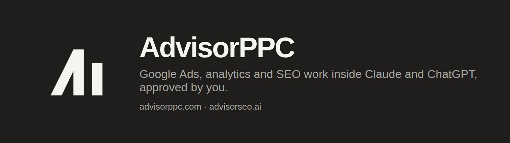

# AdvisorPPC

Google Ads, analytics and SEO work inside Claude and ChatGPT, approved by you.

- **AdvisorPPC**: [advisorppc.com](https://advisorppc.com). Connect Google Ads, GA4, Search Console, Tag Manager and YouTube to Claude.
- **AdvisorSEO**: [advisorseo.ai](https://advisorseo.ai). Keyword, content and site reviews for your website.

## Plugins for Claude Code

| Plugin | What it does |
|---|---|
| [advisorppc-plugin](https://github.com/advisorppc-org/advisorppc-plugin) | Audit and manage Google Ads, GA4, Search Console, Tag Manager and YouTube from Claude. Hosted MCP, browser sign-in, no API keys. |
| [advisorseo-claude-plugin](https://github.com/advisorppc-org/advisorseo-claude-plugin) | Keyword, content and site reviews in Claude through the hosted AdvisorSEO connector. |

Questions: [contact@advisorppc.com](mailto:contact@advisorppc.com)
